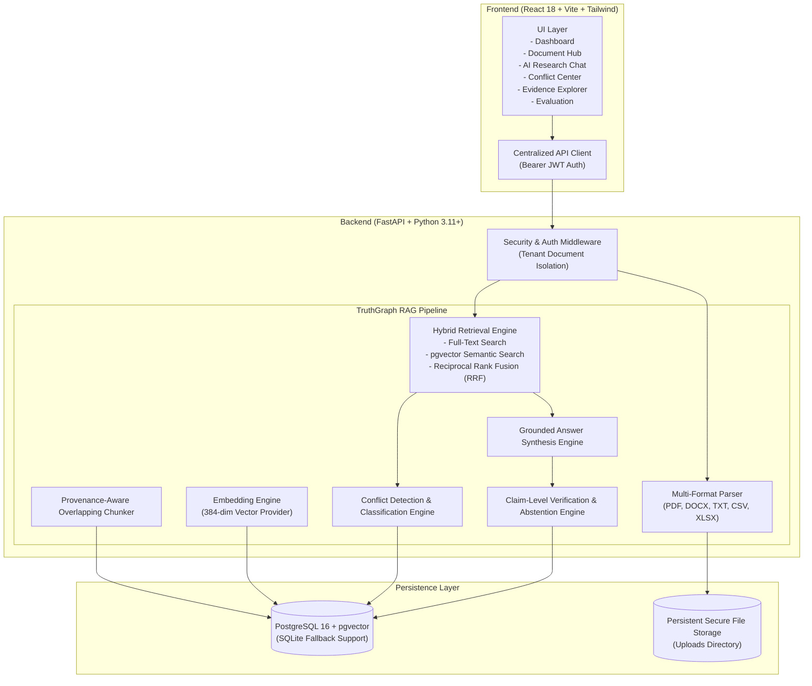

# TruthGraph AI — Architectural Specification

## 1. High-Level Architecture Overview

TruthGraph AI is an enterprise-grade Retrieval-Augmented Generation (RAG) platform that answers complex questions across heterogeneous data sources while rigorously verifying evidence, resolving contradictions, preventing hallucinations, and citing exact source provenance.

## 2. Ingestion & Extraction Pipeline

TruthGraph AI provides format-specific extractors preserving source location metadata:
- **PDF**: Page-aware extraction (`pypdf` / `PyMuPDF`) maintaining physical page numbers.
- **DOCX**: Structured paragraph and table extraction (`python-docx`).
- **CSV**: Row-by-row context preservation with column headers prepended to each entity.
- **XLSX**: Multi-sheet extraction retaining sheet names and row indices (`openpyxl`).
- **TXT**: Section and paragraph chunking preserving exact offsets.

Each document computes a SHA-256 checksum upon upload to prevent duplicate processing within a user's tenancy.

## 3. Hybrid Retrieval & Rank Fusion

The retrieval system employs a dual-channel search architecture:
1. **Keyword / Lexical Search**: Uses PostgreSQL `to_tsvector` and `plainto_tsquery` (or token-overlap scoring on SQLite).
2. **Semantic Vector Search**: Uses pgvector cosine similarity distance (`<->`) or in-memory vector cosine similarity.
3. **Reciprocal Rank Fusion (RRF)**:
   $$\text{RRF Score}(d) = \sum_{m \in \{\text{keyword}, \text{semantic}\}} \frac{1}{60 + \text{rank}_m(d)}$$
This guarantees high recall while mitigating semantic drift or keyword mismatch.

## 4. Conflict Detection & Classification

The Conflict Detection Engine evaluates retrieved passage pairs to discover:
- **Factual Disagreements**: Polarizing claims about the same subject or entity.
- **Outdated Policies**: Discrepancies between historical audit statements and current operational inventory.
- **Exception Clauses**: Approved temporary exemptions qualifying baseline security policies.
- **Differing Scope Contexts**: Distinguishing general organizational guidelines from departmental rules.

## 5. Claim-Level Verification & Abstention

Rather than presenting raw LLM output, TruthGraph AI enforces post-generation verification:
1. Extracts meaningful factual claims from the candidate response.
2. Maps each claim to supporting passage chunks.
3. Classifies each claim as `supported`, `partially_supported`, `contradicted`, or `insufficient_evidence`.
4. Enforces strict citation validation: every citation `[x]` must link to an authorized, retrieved passage chunk.
5. If evidence is lacking or central claims are contradicted, the engine qualifies the answer or abstains entirely.

## 6. Security & Tenant Isolation

- **Authentication**: JWT tokens signed using HS256 with bcrypt password hashing.
- **Authorization**: All database queries enforce `owner_id == current_user.id` on documents, chunks, conversations, and conflicts.
- **Sanitized Audit Logging**: Security-relevant actions (`USER_LOGIN`, `DOCUMENT_UPLOAD`, `QUERY_ASKED`, `CONFLICT_REVIEWED`) are recorded without logging passwords, tokens, or confidential document bodies.
